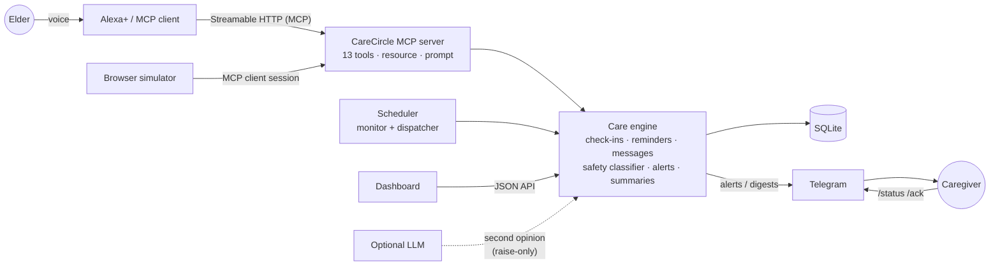

# CareCircle

**A voice-first family check-in server for Alexa+, built on MCP.**

An older relative living alone just talks to Alexa+: *"Good morning"*, *"I took my tablet"*, *"tell my son to call me"*.
CareCircle turns that into check-ins, confirmed routines, family messages and **safety alerts** that reach the
people who care, with no extra app for the elder to learn, in **English, Hindi and Marathi**.

> CareCircle is a family notification aid. It is **not** a medical device or an emergency service, never gives
> medical advice, and never changes medication.

<p>


</p>

## Why

Millions of families have a parent living alone while the children study or work in another city. Calling every
day is hard, smart-home alerts are noisy and impersonal, and apps are a barrier for older users. Voice is the
interface they already accept. CareCircle gives that voice a memory and a conscience: it notices what was said,
what was missed, and tells the right person.

## What it does

| Capability | How it works |
|---|---|
| **Daily check-in** | `log_checkin` records what the elder said (any language) and an optional mood. |
| **Concern detection** | Offline, multilingual rules (falls, chest pain, breathing, dizziness, not eating, loneliness...) with negation handling (`no chest pain`, `चक्कर नहीं`). An optional LLM can *raise* severity, never lower it. |
| **Routines with confirmation** | Caregivers create reminders; the elder confirms by voice (`confirm_reminder`). Ambiguity returns `needs_clarification` so the assistant asks "which one?". |
| **Smart escalation** | Missed check-in: one gentle nudge, then one alert per day. Unconfirmed routine: marked missed, then alerted. Duplicate alerts are suppressed; a *more severe* alert always goes through. |
| **Family messages** | `leave_message` between people in the same circle; elders hear them next time they talk (read-once). |
| **Daily digest** | Plain-language evening summary pushed to caregivers. |
| **Notifications** | Telegram (free) with `/status` and `/ack <id>`; log-only fallback with zero config. |
| **Alexa+ simulator** | Browser mic, spoken replies, and a live **MCP tool-call log** (real MCP traffic) plus a "caregiver's phone". |
| **Caregiver dashboard** | Today, alerts, routines, messages, care circle, 7-day timeline. |
| **Demo mode** | Seeds a family and adds time-travel buttons so escalation can be shown in seconds. |

## Architecture



* **Domain layer** (`services/`) has no knowledge of MCP or HTTP, so it is unit-tested in isolation with an
  injectable clock.
* **MCP layer** (`server.py`) is a thin, typed adapter. Domain errors become structured results, never stack traces.
* **Delivery** is decoupled behind a `Notifier` protocol; alerts are pushed the instant they are created and
  retried by the scheduler if delivery fails.

## Quick start

```bash
git clone <this repo> && cd carecircle
python -m venv .venv && source .venv/bin/activate          # Windows: .venv\Scripts\activate
pip install -e ".[dev]"
pytest -q                                                    # 238 tests

python -m carecircle serve --demo
#  MCP endpoint  http://127.0.0.1:8000/mcp
#  Simulator     http://127.0.0.1:8000/sim
#  Dashboard     http://127.0.0.1:8000/dashboard
```

Open the **simulator** and **dashboard** side by side. Say (or click): *"I fell down in the bathroom"*, and watch
the MCP calls, the caregiver's phone and the dashboard react. Use the dashboard's **+2 h** to jump the clock and see
a missed-check-in escalate.

Drive it from any MCP client instead:

```bash
python scripts/mcp_client_demo.py --url http://127.0.0.1:8000/mcp [--token ...]
```

## Connecting it to Alexa+

CareCircle implements the MCP **Streamable HTTP** transport (this build negotiates protocol revision `2026-07-28`).
To use it with Alexa+, expose the `/mcp` endpoint over HTTPS, set a bearer token, and register the URL following
Amazon's current Alexa+ MCP integration documentation:

```bash
CARECIRCLE_MCP_TOKEN=$(openssl rand -hex 24) \
CARECIRCLE_ALLOWED_HOSTS=my-app.example.com \
python -m carecircle serve --host 0.0.0.0
```

Free HTTPS options: a Cloudflare Tunnel or ngrok in front of your laptop, or any free container host using the
included `Dockerfile`. See [Security](#security) before exposing it.

> The simulator is the stand-in for the device: it is a real MCP client calling the real server, so what it shows
> is genuine protocol traffic, but it is not Alexa+ itself.

## MCP surface

| Tool | Purpose |
|---|---|
| `log_checkin(person?, note, mood?)` | Record a check-in; auto-detect concerns and alert family. Returns `assistant_guidance`. |
| `get_pending_items(person?)` | Due reminders + read-once family messages. |
| `confirm_reminder(person?, status, reminder?)` | Mark `taken` / `skipped`; asks to clarify when ambiguous. |
| `create_reminder(person, title, time, days?, requested_by?)` | Recurring routine (`daily`, `weekdays`, `mon,wed`...). |
| `list_reminders` / `cancel_reminder` | Manage routines. |
| `leave_message(sender, recipient, message)` | Message within a care circle. |
| `raise_alert(person, reason, severity)` | Caregivers on request ("tell my son I need him"). |
| `get_recent_alerts` / `acknowledge_alert` | Review and close the loop. |
| `get_daily_summary(person?, day?)` | Plain-language digest. |
| `get_missed_checkins()` | Who is `due` or `missed` right now (read-only). |
| `list_people()` | Circle membership. |

Plus the resource `care://people/{person}/timeline` (7-day JSON) and the prompt `checkin_conversation`.
Every tool carries accurate `readOnly` / `idempotent` / `destructive` annotations, and a single-elder household
never needs to say whose check-in it is.

## Configuration

All via environment variables; see [`.env.example`](.env.example) for the full list.

| Variable | Default | Meaning |
|---|---|---|
| `CARECIRCLE_MCP_TOKEN` | *(none)* | Bearer token required on `/mcp` and `/api`. **Set it off-localhost.** |
| `CARECIRCLE_ALLOWED_HOSTS` | *(none)* | Public hostnames when behind a tunnel/proxy. |
| `CARECIRCLE_TIMEZONE` | `Asia/Kolkata` | Default timezone for new people. |
| `CARECIRCLE_CHECKIN_DEADLINE` | `10:00` | Elders are expected to check in by then. |
| `CARECIRCLE_GRACE_MINUTES` | `60` | Nudge during grace, alert after. |
| `CARECIRCLE_TELEGRAM_BOT_TOKEN` | *(none)* | Enables Telegram alerts and `/status`, `/ack`. |
| `CARECIRCLE_LLM_BASE_URL` / `_MODEL` / `_API_KEY` | *(none)* | Any OpenAI-compatible endpoint (Groq, Gemini, OpenRouter, Ollama). |
| `CARECIRCLE_DEMO` | `0` | `1` seeds demo data and enables time travel. |

### Telegram in two minutes (free)

1. Message **@BotFather** → `/newbot` → copy the token into `CARECIRCLE_TELEGRAM_BOT_TOKEN`.
2. Start the server, message your bot `/start`: it replies with your chat id.
3. `carecircle link-telegram Rahul <chat_id>`. Alerts, messages and the evening digest now arrive on your phone;
   reply `/ack 12` to close an alert.

## Security

* **Bearer auth** (constant-time compare) on `/mcp` and `/api`; health and static pages are open and contain no data.
* **DNS-rebinding protection**: Host headers are validated on every route when bound to loopback or when
  `CARECIRCLE_ALLOWED_HOSTS` is set; a public bind without either logs a warning.
* **CSRF**: state-changing API calls require a custom header, which forces a CORS preflight, so a hostile web page
  cannot drive a token-less local instance.
* **Strict CSP** (`default-src 'none'; script-src 'self'; ...`), no inline scripts or styles, and all dynamic UI text
  is set via `textContent`, so elder-supplied text can never inject markup.
* **Privacy by design**: only text notes are stored (never audio), circle membership gates messaging, and the
  Telegram token is kept out of logs.

## Testing

```bash
pytest -q          # 238 tests: domain, safety, MCP end-to-end, HTTP, auth, CSP, dispatch, agent, i18n
ruff check src tests scripts
```

The suite covers real MCP client sessions against the server, bearer/host/CSRF behaviour, Telegram and LLM clients
(mocked transports), the scheduler thread, escalation timing with a fixed clock, and multilingual safety phrases.

## Project layout

```
src/carecircle/
  server.py        MCP tools, resource, prompt        app.py / api.py / web.py   HTTP, JSON API, UI
  services/        care engine (no MCP/HTTP knowledge) safety.py                 concern detection
  agent.py         simulator agents (rules + LLM)      notifier/                  Telegram, console
  scheduler.py     monitor + dispatch loop             i18n.py                    en / hi / mr replies
  web/             dashboard & simulator (vanilla JS)  llm.py                     optional LLM client
tests/  scripts/  docs/  Dockerfile  docker-compose.yml
```

## Limitations & honesty

* Hindi and Marathi strings and keyword rules were written without a native-speaker review: **please review before
  real-world use**. Rule-based detection is deliberately conservative but cannot catch everything.
* Nudges reach an elder only through a channel they have (e.g. Telegram); a true proactive Alexa+ announcement
  depends on platform capabilities outside this project.
* Single-node SQLite by design: ideal for a household or small deployment, not a multi-tenant SaaS as shipped.
* The `Dockerfile` and CI workflow are provided but were not executed in the authoring sandbox.

## License

MIT, see [LICENSE](LICENSE).
